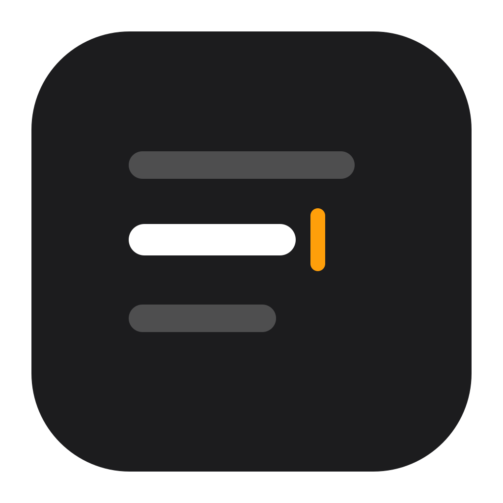

<p align="center"></p>

# Margin

A minimal, distraction-free markdown editor for macOS. Just you and the text.

- Plain-text markdown editing in a single centered column, no toolbar, no preview, no title bar.
- **Word count**, quietly in the corner.
- **Typewriter mode** (View → Typewriter Mode, `⇧⌘T`) keeps the line you're writing vertically centered.
- Open, save, autosave, versions and recent files, like any Mac document app.

## Download

Grab `Margin.zip` from the [latest release](../../releases/latest), unzip, and drag `Margin.app` to Applications. It's a universal app (Apple Silicon and Intel) but isn't notarized, so the first time, right-click it and choose Open (or run `xattr -dr com.apple.quarantine Margin.app`).

## Build

Needs macOS 14+ and the Swift toolchain (Xcode or just the Command Line Tools). No Xcode project, no dependencies.

```sh
./build.sh && open Margin.app
```

To open a file: `open -a Margin.app notes.md`.

The app icon is generated from `assets/logo.svg` with `assets/make-icon.sh`.

## License

[GPL-3.0-or-later](LICENSE). Derivative works must be released under the same license.
